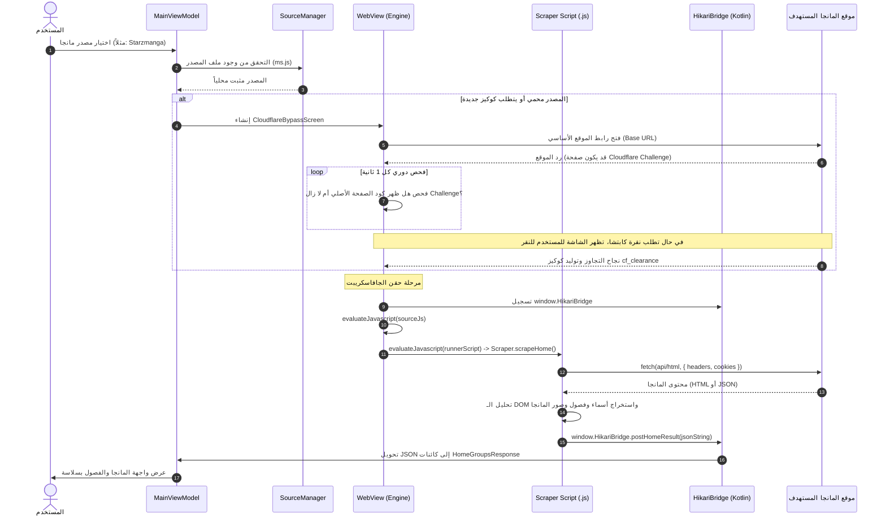

# توثيق المعمارية التقنية لنظام سكراب المصادر (Scraper System Architecture)
### تطبيق Hikari Manga

---

## 1. نظرة عامة (System Overview)

يعتمد تطبيق **Hikari Manga** على معمارية ديناميكية هجينة (Hybrid Dynamic Architecture) تدمج بين كود التطبيق الأصلي المكتوب بـ **Kotlin / Jetpack Compose** وبين محرك استخراج بيانات مبني على **JavaScript** يتم تنفيذه محلياً على جهاز المستخدم عبر محرك **Android WebKit (WebView)**.

### الأهداف الجوهرية لهذه المعمارية:
1. **تحديث وتعديل المصادر بدون تحديث التطبيق (OTA Updates)**: يمكن إصلاح أي موقع مانجا عند تغيير هيكله البرمجي عن طريق تحديث ملف الـ JS على خادم الـ Extensions، ويقوم التطبيق بتنزيله وتشغيله فوراً دون الحاجة لرفع تحديث جديد لمتجر التطبيقات أو انتظار مراجعة الـ APK.
2. **تجاوز أنظمة الحماية المعقدة (Cloudflare Turnstile & Bot Management)**: المواقع المحمية بحمايات السحاب تتطلب بيئة متصفح حقيقية لحل تشفير الـ Challenge وتنفيذ الـ Fingerprinting وإنشاء كوكيز `cf_clearance`. يوفر الـ WebView بيئة متصفح Chromium حقيقية كاملة.
3. **توزيع حمل المعالجة (Client-Side Scraping)**: تتم عمليات السكراب والتصفح على جهاز المستخدم مباشرة، مما يحمي سيرفر التطبيق من الحظر IP Bans ويقلل تكاليف السيرفر إلى الصفر تقريباً.

---

## 2. المكونات الأساسية للنظام (Core Architecture Components)

```
┌────────────────────────────────────────────────────────────────────────┐
│                        خادم الميتاداتا والسيرفرات                      │
│                (GitHub Releases / servers.json CDN)                    │
└───────────────────────────────────┬────────────────────────────────────┘
                                    │
                         تنزيل ملفات الـ JS والـ JSON
                                    ▼
┌────────────────────────────────────────────────────────────────────────┐
│                        SourceManager (Kotlin)                          │
│        - إدارة الملفات في التخزين الداخلي (context.filesDir/sources)   │
│        - فك التشفير والتحقق من الإصدارات وحالة التثبيت                 │
└───────────────────┬────────────────────────────────┬───────────────────┘
                    │                                │
          مسار التشغيل الخفي                مسار التجاوز والتحقق
         (Headless Execution)             (Cloudflare Interactive)
                    ▼                                ▼
┌──────────────────────────────────────┐ ┌───────────────────────────────┐
│       JsScraperRunner (Headless)     │ │ CloudflareBypassScreen (UI)   │
│ - WebView خفي في الذاكرة بدون واجهة  │ │ - شاشة تجاوز ذكية وصامتة      │
│ - استدعاء سريع باستخدام الكوكيز      │ │ - حل التحدي التلقائي أو اليدوي│
└───────────────────┬──────────────────┘ └───────────────┬───────────────┘
                    │                                    │
                    └─────────────────┬──────────────────┘
                                      ▼
             ┌─────────────────────────────────────────────────┐
             │       جسر التواصل (JavaScript Bridge Interface) │
             │           window.HikariBridge                   │
             └────────────────────────┬────────────────────────┘
                                      ▼
             ┌─────────────────────────────────────────────────┐
             │         MainViewModel & Repositories            │
             │           (عرض البيانات في واجهات Compose)       │
             └─────────────────────────────────────────────────┘
```

### 1. `servers.json` (الفهرس المركزي للمصادر)
ملف JSON استاتيكي يتم جلبه من CDN، يحدد المصادر المتاحة ورابط التحميل لكل مصدر:
```json
{
  "server": "ms",
  "type": "ar",
  "referer": "https://starzmanga.net/",
  "isWebsiteProtected": true,
  "fileLink": "https://github.com/.../starzmanga-release.json"
}
```

### 2. `SourceManager.kt` (مدير المصادر المحلي)
مسؤول عن:
- تنزيل حزمة المصدر (`*-release.json`) وحفظ ملف الـ JavaScript في المسار الداخلي للتطبيق:
  `context.filesDir/sources/{serverId}.js`
- قراءة وتجهيز كود الجافاسكريبت وروابط الفحص (`checkUrl`, `baseUrl`).

### 3. `CloudflareBypassManager.kt` (خزينة بيانات الاعتماد)
يقوم بتخزين واسترجاع كوكيز الحماية (`Cookie`) والـ User-Agent الخاصة بكل موقع داخل `EncryptedSharedPreferences` مشفرة.

---

## 3. مسارا التشغيل (Two Scraping Execution Modes)

### المسار الأول: المشغل الخفي بدون شاشة (Headless Runner - `JsScraperRunner.kt`)
يُستخدم هذا المسار عند طلب الفصول، تفاصيل المانجا، البحث، أو القائمة الرئيسية في حال كانت الكوكيز الصالحة مخزنة مسبقاً:
1. يتم إنشاء كائن `WebView` برمجياً في الذاكرة (Off-screen Headless WebView) دون إضافته إلى أي واجهة مستخدم (UI View Hierarchy).
2. يتم تفعيل إعدادات توفير البيانات (مثل `blockNetworkImage = true`) لعدم استهلاك الإنترنت في تحميل الصور غير الضرورية.
3. يتم حقن الكوكيز المخزنة لنطاق الموقع.
4. يتم حقن ملف الـ JS وتشغيل دالة الاستخراج.
5. بمجرد استلام النتيجة عبر الجسر، يتم تدمير الـ WebView وتحرير الذاكرة فوراً (`webView.destroy()`).

### المسار الثاني: شاشة التجاوز الذكية والصامتة (Smart Silent Bypass - `CloudflareBypassScreen.kt`)
يُستخدم عندما يكون الموقع محمياً بحماية نشطة وتتطلب استخراج كوكيز جديدة:
1. **الوضع الصامت (Silent Mode)**: تبدأ العملية والـ WebView غير مرئي تماماً بينما يظهر للمستخدم شاشة تحميل أصلية (Native Loading Spinner).
2. **فحص الـ Challenge التلقائي**:
   - يتم حقن سكربت مراقبة يقرأ حالة DOM كل 1000ms.
   - إذا تم رصد تحدي Turnstile كابتشا صامت (JS Challenge)، يُمنح مهلة 3.5 ثوانٍ ليتجاوز نفسه تلقائياً دون إزعاج المستخدم.
3. **الوضع التفاعلي (Interactive Mode)**:
   - إذا كان التحدي يتطلب نقرة يدوية من المستخدم ("Verify you are human")، تصبح شاشة الـ WebView مرئية فوراً مع إمكانية النقر على الكابتشا.
4. بمجرد حل التحدي بنجاح (`SUCCESS`):
   - يتم استخراج الكوكيز والـ User-Agent وحفظها للمستقبل.
   - يتم حقن ملف الـ JS فوراً داخل نفس جلسة المتصفح النشطة لجلب الصفحة الرئيسية وإرسالها للتطبيق، ثم إخفاء الشاشة بسلاسة.

---

## 4. آلية حقن ملف الـ JS داخل الـ WebView بالتفصيل

تعتبر هذه العملية القلب النابض للنظام، وتتم عبر 4 مراحل دقيقة:

### المرحلة 1: ضبط إعدادات الـ WebView والـ Cookies
قبل تشغيل أي كود، يتم ضبط بيئة الـ WebView لتعمل كمتصفح سطح مكتب/هاتف قياسي:

```kotlin
val webView = WebView(context).apply {
    settings.apply {
        javaScriptEnabled = true            // تفعيل تنفيذ الجافاسكريبت
        domStorageEnabled = true             // تفعيل LocalStorage / SessionStorage
        cacheMode = WebSettings.LOAD_DEFAULT
        mixedContentMode = WebSettings.MIXED_CONTENT_ALWAYS_ALLOW
        allowFileAccess = true
        allowContentAccess = true
        // استخدام نفس الـ User-Agent المعتمد
        userAgentString = customUA ?: settings.userAgentString
    }

    // حقن كوكيز كلودفلار السابقة (إن وجدت) لكي يتعرف الموقع على الجلسة
    val cookieManager = CookieManager.getInstance()
    cookieManager.setAcceptCookie(true)
    cookieManager.setAcceptThirdPartyCookies(this, true)
    cookieManager.setCookie(targetUrl, savedCookies)
    cookieManager.flush()
}
```

---

### المرحلة 2: بناء وتسجيل جسر الـ JavaScript (JS Bridge)

لإنشاء قناة تواصل ثنائية الاتجاه لنقل البيانات من بيئة متصفح الـ JavaScript إلى كود Kotlin:

1. يتم تعريف فئة عامة (Public Class) تحتوي على دوال موسومة بتعليمة `@JavascriptInterface`:

```kotlin
class CloudflareBridgeInterface(
    private val onResult: (String) -> Unit,
    private val onError: (String) -> Unit
) {
    @JavascriptInterface
    fun postHomeResult(jsonString: String) {
        // يتم استدعاؤها من داخل JavaScript عند نجاح جلب البيانات
        onResult(jsonString)
    }

    @JavascriptInterface
    fun postHomeError(err: String) {
        // يتم استدعاؤها من داخل JavaScript عند حدوث خطأ
        onError(err)
    }
}
```

2. يتم حقن هذا الكائن في الـ WebView باسم كائن عام في الـ JavaScript:
```kotlin
webView.addJavascriptInterface(bridgeInstance, "HikariBridge")
```
*أصبح الآن كود الـ JavaScript يمتلك كائناً عالمياً باسم:* `window.HikariBridge`.

---

### المرحلة 3: حقن ملف سكراب المصدر (Evaluating Source JS)

يقوم التطبيق بقراءة ملف المصدر كاملاً كنص من التخزين الداخلي للهاتف، ثم يحقنه في الـ DOM الخاص بالصفحة عبر `evaluateJavascript`:

```kotlin
val sourceJs = SourceManager.getSourceJs(context, serverId) // محتوى كود السكراب كاملاً

webView.evaluateJavascript(sourceJs) { evalResult ->
    // تم تسجيل كائن السكراب في ذاكرة الصفحة (window.Scraper)
    android.util.Log.d("HikariSource", "Source script injected successfully")
}
```

---

### المرحلة 4: استدعاء الدالة عبر غلاف تنفيذي (IIFE Runner Injection)

بعد حقن ملف السكراب، يقوم التطبيق بتوليد وحقن سكربت تنفيذي فوري (Immediately Invoked Function Expression - IIFE) غير متزامن (`async/await`) يقوم بالآتي:
1. التحقق من وجود دالة السكراب المطلوبة (مثلاً `Scraper.scrapeHome`).
2. استدعاء الدالة وتمرير المتغيرات المطلوبة: `(options, cookies, userAgent)`.
3. التقاط النتيجة وإرسالها كنص JSON عبر `window.HikariBridge.postHomeResult(...)`.
4. التقاط أي استثناء (Exception) أو اعتراض كابتشا وإرساله عبر `window.HikariBridge.postHomeError(...)`.

```kotlin
val escapedCookies = cookies.replace("\\", "\\\\").replace("'", "\\'")
val escapedUA = userAgent.replace("\\", "\\\\").replace("'", "\\'")

val runnerScript = """
    (async () => {
        try {
            // 1. تحديد الدالة المطلوبة
            const fn = (typeof Scraper !== 'undefined' && Scraper.scrapeHome) 
                ? Scraper.scrapeHome 
                : (typeof scrapeHome !== 'undefined' ? scrapeHome : null);
                
            if (!fn) {
                window.HikariBridge.postHomeError("Scraper.scrapeHome is not defined in script");
                return;
            }

            // 2. استدعاء دالة السكراب مع الكوكيز والبصمة
            const res = await fn({ query: 'x-all', page: 1 }, '$escapedCookies', '$escapedUA');

            // 3. معالجة حالة حظر Cloudflare 403
            if (res && res.success === false) {
                if (res.error === 'CF_BLOCKED_403' || res.statusCode === 403 || (res.error && res.error.includes('403'))) {
                    window.HikariBridge.postHomeError("CF_BLOCKED_403");
                } else {
                    window.HikariBridge.postHomeError(res.error || "فشل جلب بيانات المصدر");
                }
                return;
            }

            // 4. إرسال النتيجة الناجحة إلى تطبيق أندرويد
            window.HikariBridge.postHomeResult(JSON.stringify(res));

        } catch (err) {
            // 5. التقاط أي انهيار في بيئة الـ JS وإرساله للتطبيق
            const msg = err ? (err.stack || err.message || String(err)) : "Unknown scraping error";
            if (msg.includes("403") || msg.includes("CF_BLOCKED")) {
                window.HikariBridge.postHomeError("CF_BLOCKED_403");
            } else {
                window.HikariBridge.postHomeError(msg);
            }
        }
    })();
""".trimIndent()

// تنفيذ السكربت المشغل
webView.evaluateJavascript(runnerScript, null)
```

---

## 5. المخطط التسلسلي التفاعلي (Mermaid Sequence Diagram)



---

## 6. مواصفات عقد ملف السكراب (JavaScript Scraper Contract)

لكي يعمل أي ملف سكراب مع تطبيق Hikari Manga، يجب أن يصدر كائناً عالمياً باسم `Scraper` يحتوي على الدوال الأربع التالية:

```javascript
const Scraper = {
    /**
     * 1. استخراج الصفحة الرئيسية وتصنيفاتها
     * @param {Object} options { query: 'x-all' | 'views' | 'latest', page: 1 }
     * @param {string} cookies كوكيز الجلسة المشفرة
     * @param {string} userAgent بصمة المتصفح المعتمدة
     * @returns {Promise<{success: boolean, server: string, data: Array, error?: string}>}
     */
    async scrapeHome(options, cookies, userAgent) {
        // جلب الـ HTML أو استدعاء API المصدر
        // إرجاع مصفوفة من المجموعات HomeGroup التي تحتوي على MangaItems
    },

    /**
     * 2. استخراج تفاصيل العمل وقائمة الفصول
     * @param {string} slug معرّف المانجا (الرابط الفرعي)
     */
    async scrapeDetails(slug, cookies, userAgent) {
        // إرجاع عنوان، قصة، تقييم، تصنيفات، وقائمة الفصول Chapters
    },

    /**
     * 3. استخراج روابط صور الفصل للقراءة
     * @param {string} chapterUrlOrSlug رابط الفصل أو المعرّف
     */
    async scrapePages(chapterUrlOrSlug, cookies, userAgent) {
        // إرجاع مصفوفة روابط الصور المباشرة (Images URLs)
    },

    /**
     * 4. البحث عن الأعمال داخل المصدر
     * @param {string} query نص البحث
     * @param {number} page رقم الصفحة
     */
    async scrapeSearch(query, page, cookies, userAgent) {
        // إرجاع نتائج البحث المطابقة
    }
};
```

### معالجة أخطاء الكلودفلار داخل السكراب:
إذا واجه السكراب استجابة HTTP 403 أو رصد صفحة Cloudflare في الـ HTML المرجع، يجب أن يعيد:
```javascript
return {
    success: false,
    statusCode: 403,
    error: "CF_BLOCKED_403"
};
```
يقوم التطبيق فور استلام `CF_BLOCKED_403` بحذف الكوكيز القديمة وإطلاق واجهة التجاوز فوراً لحل الكابتشا وتجديد الجلسة.

---

## 7. اعتبارات حماية وتجميع الـ APK (ProGuard / R8 Rules)

أثناء بناء نسخة الإنتاج النهائية (**Release APK**)، يقوم محرك **R8** بحذف وتصغير الأكواد غير المستخدمة مباشرة في لغة Kotlin. 
بما أن دوال جسر الـ WebView تُستدعى عبر **الانعكاس (Reflection)** من بيئة الـ JavaScript، يجب إدراج القواعد التالية في `proguard-rules.pro` لضمان عدم حذفها أو تغيير أسمائها:

```proguard
# 1. الحفاظ على تعليمة ودوال الجافاسكريبت إنترفيس
-keepattributes JavascriptInterface
-keepclassmembers class * {
    @android.webkit.JavascriptInterface <methods>;
}

# 2. الحفاظ على فئات الجسور العامة بالكامل
-keep class com.jxj.hikarimanga.ui.screens.CloudflareBridgeInterface { *; }
-keep class com.jxj.hikarimanga.data.source.JsScraperBridgeInterface { *; }

# 3. الحفاظ على مدراء المصادر ونماذج البيانات الخاصة بها
-keep class com.jxj.hikarimanga.data.source.** { *; }
-keep class com.jxj.hikarimanga.data.model.** { *; }
-keep class com.jxj.hikarimanga.data.mock.** { *; }
```

> [!IMPORTANT]
> يجب أن تكون فئة الجسر (`BridgeInterface`) دائماً فئة عامة `public` وليست فئة محلية خاصة داخل دالة (Local inner class)، لأن محرك WebKit في نظام أندرويد يتطلب وصول Reflection عام ليتمكن من استدعاء الدوال من الجافاسكريبت.
